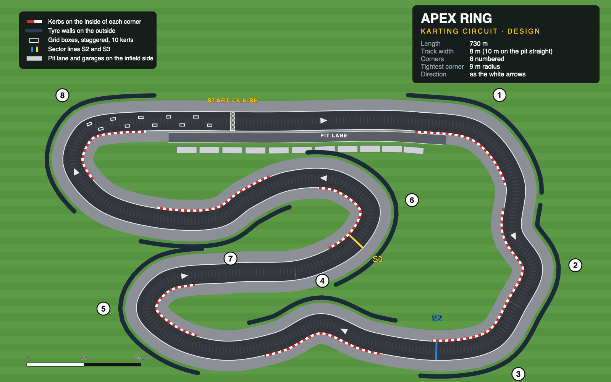
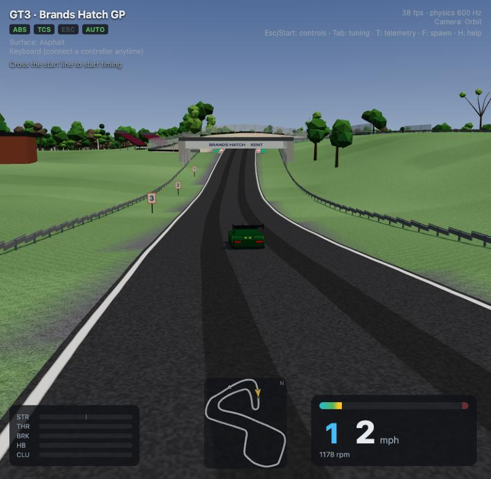
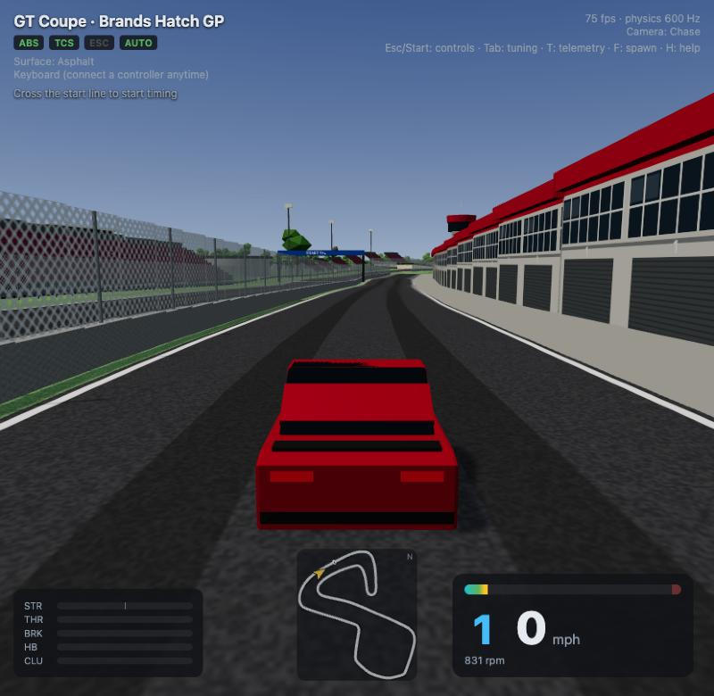
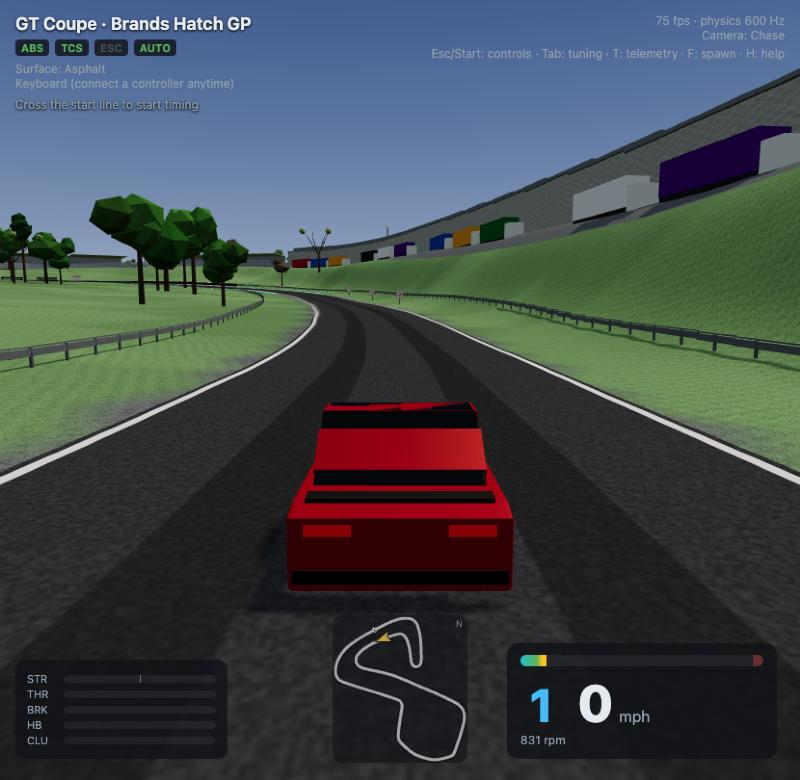
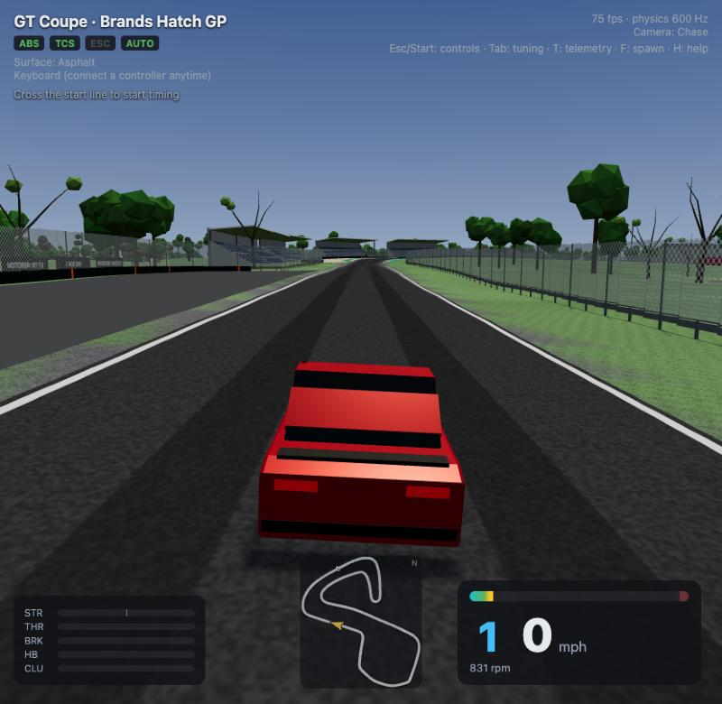
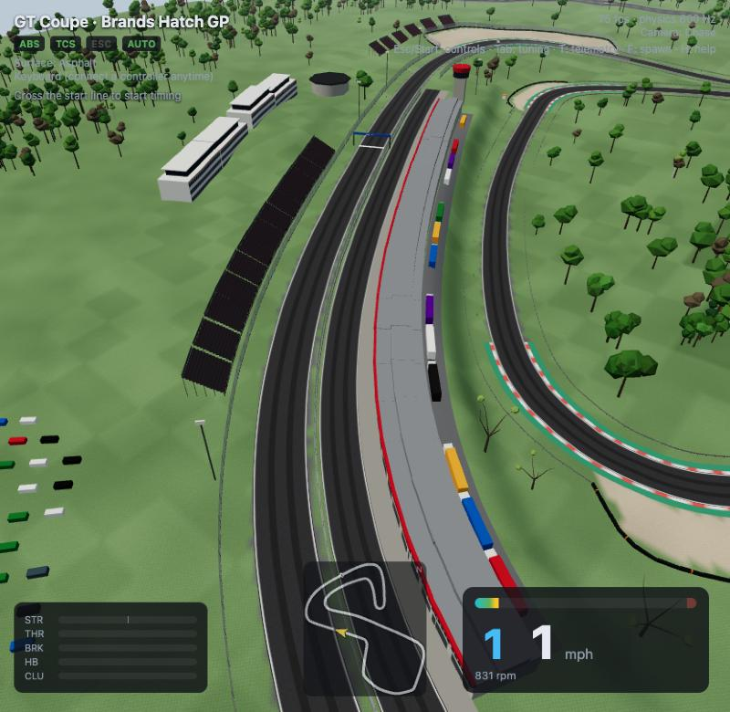

# Vehicle Sim Sandbox

A data-driven, simulation-grade vehicle physics base for racing and driving games,
with a browser test environment (track, jumps, ten surfaces), keyboard, and full
game controller / wheel support with calibration.

The physics core (`src/physics/`) has **zero dependencies**. It doesn't know about
Three.js, the DOM, or input. Port it to another engine, or drop it into any JS game.

## Run it

```bash
node tools/serve.js
```

Then open http://localhost:8080. Any static file server works, but ES modules need http://, not file://.

```bash
npm run test:physics
```

```bash
npm run test:walls
```

`test:physics` is a headless regression run: 0–100 km/h, braking g, steady-state cornering g,
and stability runs (with lane keeping) through every jump lane, for every preset. `test:walls` crashes
five cars into a wall head-on, at glancing angles up to 220 km/h and sideways, checking for
pass-through and stability.

## Controls

| Action | Keyboard | Xbox-style pad |
|---|---|---|
| Throttle / brake | W S · ↑ ↓ | RT / LT (analog) |
| Steer | A D · ← → | Left stick |
| Handbrake | Space | A |
| Shift up / down | E / Q | B / X |
| Clutch | Z | LB |
| Camera / look back | C / B | Y / RB |
| Reset car | R | View/Back |
| Telemetry | T | D-pad up |
| Menu: Create Race · Controls · Vehicle | Esc | Start (LB/RB switch tabs) |
| Tuning panel | Tab | — |
| Spawn points | F (cycle), 1–8 | — |
| Next/prev car | ] / [ | — |
| Auto/manual gearbox | G | (pressing a shift button switches to manual) |
| Units (mph default) / mute / slow-mo / help | U / M / P / H | — |
| Track map on/off | N | — |
| Quick practice vs one opponent / skill | O / K | — |
| Next map (reloads) | L | — |

**Track map:** a north-up map at the bottom centre (70% opacity) showing the circuit, the walls in red, the start line and the infield test areas, with your car as a heading arrow. Off the map, the arrow sits hollow on the edge. On narrow windows the map moves to the top right.

**Drift meter** (every car): slide past 12° above 20 km/h and the HUD shows live angle and a combo (angle × speed). Recover for 1.2 s to bank it into your total; spinning out or crashing loses it. Resets on spawn.

In automatic mode, hold the brake at a standstill to engage reverse.

## Controller support & calibration (Esc / Start)

- **Any Gamepad API device:** pads, wheels, pedals, shifters, button boxes. Pick the device from the list. The "standard mapping" pads (Xbox, PlayStation, most modern pads) get sensible bindings automatically.
- **Bind wizard:**
  - **Steering:** click *Bind*, turn fully right and hold, then fully left and hold. This captures the axis, both extremes and the centre, so off-centre or asymmetric wheels work.
  - **Pedals and triggers:** press fully and hold. The wizard records the rest value and the full-travel value, so inverted pedals (rest at +1) and short-travel pedals (only reach −0.4) map to a clean 0–1.
  - **Buttons:** press the button.
- **Per-axis response curves:** inner deadzone, outer saturation and linearity (γ), with a live in→out plot.
- **Re-centre and Invert** per axis.
- **Steering mode:**
  - *Gamepad:* rate-limited, speed-sensitive lock, countersteer assist.
  - *Wheel:* direct 1:1, no filtering. Unrecognised devices default to linear, no-deadzone steering.
- **Rumble (dual-rumble):** strong motor = landings, impacts and the rev limiter. Weak motor = tyre slip past peak, ABS pulses and surface roughness. Strength slider and a test button.
- **Gamepad navigation:** the setup screen is navigable with the pad itself (D-pad, A to select, B or Start to close).
- **Saved profiles:** saved per device ID in `localStorage`.

## Maps

Switch with **L**, or the **Map** dropdown in the Tab panel (the page reloads with `?map=<id>`). The last map you used is remembered.

| Map | What it is |
|---|---|
| `test` | The proving ground: start pad, skidpad, surface strips, jump park, circuit and walled section (below). |
| `brands` | **Brands Hatch GP** (3.908 km, clockwise). See below. |
| `spa` | **Spa-Francorchamps** (7.004 km, clockwise): Eau Rouge and Raidillon, the Kemmel straight, Pouhon and Blanchimont in the Ardennes forest. See below. |
| `kart` | **Apex Ring** (723 m, clockwise): a compact karting circuit with a 150 m start straight, a hairpin, an S-bend and a technical infield. See below. |
| `city` | **Harbour Street** (1.64 km, clockwise): an urban karting circuit with a start grid and pits, about 3 m of elevation change, soft rollers and a speed hump, a stone arch bridge over a canal and a jump across the canal. Open it with `?map=city`. |

### Spa-Francorchamps

The full 7.004 km Grand Prix circuit in the Ardennes: 102 m of elevation change (364 m at Stavelot to 466 m at Les Combes), gradients up to 18% at Raidillon and 15,000 trees.

**Corners (lap distance from the start line):** La Source 420 m · Eau Rouge 1044 · Raidillon 1190 · the Kemmel straight (1.1 km) · Les Combes 2431 · Malmedy 2653 · Rivage 3139 · Pouhon 4100 (the double left) · Fagnes 4700 · Campus 5059 · Stavelot 5276 · Paul Frère 5450 · Blanchimont 6090 · the Bus Stop chicane 6866. The start line is on the pit straight, about 420 m before La Source.

**How it was built.** The layout diagram you gave me is not drawn to scale (it squeezes the Kemmel straight to a fraction of its length), so it can't be used for the geometry. The geometry is the **real GPS route** from the Strava map screenshot instead:
- `tools/trace-gps-route.py` picks the route out of the map by colour (a dark casing around a coloured core), walks it, and takes the pixel scale from the map's own 1 km markers (about 3.2 m per pixel). The map is north-up, so no rotation was needed.
- The route is cropped off the bottom of that screenshot where it passes Les Combes, Malmedy and the Rivage hairpin, so about 430 m (6% of the lap) is a bridged curve. `tools/build-spa-track.py` joins the two ends with a smooth curve leaving and rejoining along the route's own headings, sized so the closed lap is exactly 7,004 m. It is a right-hand U with a 13–14 m hairpin, as Rivage is, but its exact shape is an approximation.
- Elevation is digitised from the elevation profile (`spa-elevation.js`), stretched from the Strava segment's 6.9 km to the lap; Eau Rouge is the dip to 390 m at 1 km.
- The woodland and open pasture come from the map's colours (`tools/extract-basemap-forest.py`).
- The layout diagram was used to check the corner order (La Source, Eau Rouge, Raidillon, Les Combes, Malmedy, Rivage, Pouhon, Fagnes, Stavelot, Paul Frère, Blanchimont, the Bus Stop).

**Scenery** (`src/render/scenery/spa.js`): the painted run-off at Eau Rouge and Raidillon (red and yellow lanes on the outside of the compression, teal opposite, as in the photos), the pit lane with its two-storey garages, glazed pit building and control tower, a covered main grandstand opposite the pits and another above Raidillon, scaffold stands at La Source and Les Combes, the Bus Stop stand, boards, marshal posts, brake boards, floodlights, farmhouses on the pastures and the forest (spruce and pine with beech, with a cheap stand-in model for distant trees).

Honest limits: positions are good to roughly ±10 m (the route is a rider's GPS track and the map is about 3 m per pixel); the Les Combes–Rivage stretch is bridged, not traced; the start line is placed at the flag on the map, which may be a little off the official line; kerb, run-off and barrier layout follow the circuit's character rather than a survey; and this is a big world (2.4 km square, about 145 MB for the physics grid), so it takes a couple of seconds longer to load.


### Apex Ring (kart)



A 723 m karting circuit, 8 m wide (10 m on the pit straight), with eight numbered corners, tyre walls on both sides, kerbs on the inside of each corner, a pit lane with kart garages, a race-control tower, a covered stand, paddock tents and a tree belt. It undulates by about 3 m. It was designed first as an image (`tools/design-kart-circuit.py` draws the sheet from a list of centreline points) and the same script exports the centreline to `src/world/maps/kart-track.js`; the map is `src/world/maps/kart.js` and the surroundings `src/render/scenery/kart.js`. The AI is calibrated for it like the other circuits.

### Brands Hatch GP


- **Geometry:**
  - The centreline was extracted from a scaled layout diagram by `tools/extract-track.py` and validated: the diagram's Indy loop measures 1,947 m against the real 1,929 m.
  - It's rotated to true north using satellite imagery.
  - Curvature-adaptive smoothing irons the image-trace wobble out of the straights while keeping the corners (Druids ~29 m radius, Paddock ~63 m, Stirling's ~40 m).
  - Brabham Straight is "faired": the diagram's direction arrow put a false S-bend in it, so that stretch is replaced by the smoothest curve that joins Clark Curve and Paddock Hill (one gentle right-hand arc, as on the real circuit). Cooper Straight runs 74–90 m behind it.
- **Elevation (measured):**
  - The Indy sections (start line to Surtees, and Clark Curve to the line) use the "Raw Elevation" chart, digitised directly from the image: 176.7–195.3 m ASL.
  - The steepest grade is Paddock Hill at ~12%.
  - The GP-only loop (Pilgrim's Drop round to Clearways) isn't in the chart. It's shaped from the circuit's character inside the measured 19 m envelope, with matching values at both junctions.
  - The data is in `src/world/maps/brands-hatch-elevation.js`. Camber is estimated, including off-camber Stirling's, and its direction is fixed per corner.
  - The pit lane, garage apron and garages sit on a flat shelf that follows the straight's gradient. Beyond the paddock road the ground falls ~12 m to Cooper Straight, as the measured profile requires.
- **Track:**
  - Width is 15 m on Brabham Straight, ~12.5 m around the Indy loop and ~11 m through the GP loop.
  - Kerbs only through the corners, with green-painted run-off beside them.
  - Sandy gravel traps outside Paddock, Druids, Graham Hill, Surtees, Hawthorn, Westfield, Stirling's and Clark; tarmac run-off at Clearways. Each sits on a fixed side, tapers in and out, and lies flat.
- **Barriers:**
  - Black tyre walls with orange markers behind the gravel and run-off; silver double-rail Armco elsewhere. Barriers ease out around the traps instead of stepping.
  - A concrete pit wall, and catch fencing around the spectator areas.
- **Pit lane:** the entry lane peels off the inside of Clark Curve and the exit lane rejoins on the inside before Paddock Hill, each with white edge lines and a grass island; no kerbs where they join.
- **Buildings (low-poly, modelled on reference photos):**
  - **Pits:** two-storey pit garages with roller doors, a glazed upper floor and a red fascia; the race control tower with its red drum top; team trucks on the paddock road behind the garages.
  - **Hospitality and media:** the white multi-storey hospitality/media blocks.
  - **Grandstands:** scaffold stands with red seats and banners on Brabham Straight, at Paddock Hill and at Druids; a covered blue-seat stand at Clark Curve.
  - **Other buildings:** red hospitality barns, Hailwoods and the Kentagon.
- **Trackside:**
  - The advertising bridge at the top of Hailwood Hill, plus footbridges on Pilgrim's Drop and before Stirling's.
  - Floodlight masts, ad boards and marshal posts behind the barriers, and 3/2/1 brake boards.
  - Buildings step with the ground segment by segment, so none float on slopes.
- **Landscape:**
  - Woodland of oak, beech/ash, silver birch, bare spring trees and a few Scots pines, rendered with distance detail levels in culled tiles.
  - Mowed grass stripes on the banks, West Kingsdown housing, the M20 and a car park.
  - Buildings have collision.
- **Spawn points:** the grid, the pit lane, and approaches to Paddock Hill, Druids, Pilgrim's Drop, Hawthorn, Westfield, Dingle Dell and Clearways.

| | |
|---|---|
|  |  |
|  |  |
|  |  |
|  | |

### Graphics (Esc -> Graphics)

- **Shadow distance:** how far around the car shadows are drawn, 0-200 m (0 turns them off; beyond 90 m the shadow map doubles in resolution).
- **Render scale:** 50-150% of the screen's resolution: lower is faster, higher is sharper.
- **Time of day:** drag the clock; the sun (the moon at night), the sky and fog colours and the light levels follow. Each map's own sky settings are its noon look.
- **Time flow:** frozen, real time, or 10x / 60x / 300x / 1200x, so a race can run from day into dusk and night.

All four are saved in your browser (`src/render/Graphics.js`).

### Sound

Every car has its own procedural sound model (`src/audio/VehicleAudio.js`): the engine (a V8 sounds different from a four-cylinder, boosted cars add a turbo whistle), tyre squeal, loose-surface and kerb rumble, wall scrapes, and one-shot impacts for landings, bumps, wall hits and car-to-car contact. Your own car also has wind noise.

Opponents are heard in space: each one is quieter the further away it is, sits in the stereo image where it is on track, loses its high frequencies with distance and shifts in pitch as it passes (Doppler). Each opponent is also tuned a little differently so you can tell them apart, and everything falls silent while the menu is open.

The **Audio** tab in the menu (Esc) has volume sliders for master, engines, tyres and surfaces, impacts and scrapes, wind and opponents, switches for 3D positioning, Doppler and mute (M), and preview buttons for the engine, tyre squeal and impact sounds. Settings are saved in the browser.

### Lap timing

Cross the start/finish line to start a lap. The HUD shows the lap time, three sector splits (purple = personal best), and your best and last lap.

A lap only counts if you actually drove it forwards. Straying more than 45 m from the circuit invalidates it.

### Races and the practice opponent

**Esc** opens the menu (it pauses the game). It has three tabs:
- **Create Race:** pick the track, 1–7 opponents, their skill (Rookie, Club, Pro, Alien), the number of laps (or open practice) and your grid slot, then **Start race**. Choosing another track reloads it and starts the race there. Your last setup is remembered.
- **Bot AI:** tune the opponents, with separate settings for each skill level (see below).
- **Audio:** volumes and 3D sound options (see Sound).
- **Controls:** controller binding and calibration, steering sensitivity and rumble.
- **Vehicle:** every car with its weight, rough power, drivetrain and description. Click one to drive it.

In a race the HUD shows your position, the lap and the gap to the car ahead (or behind, if you're leading). Opponents are coloured dots on the track map. When you take the flag a results table shows the finishing order, gaps and best laps, with **Race again**, **Menu** and **Keep driving** buttons.

**Bot AI tab:** pick a level (Rookie, Club, Pro, Alien) and adjust its sliders. Changes are saved in the browser and apply straight away, even mid-race. A `*` marks a value changed from the default, and Reset puts back the defaults.

| Setting | What it does |
|---|---|
| Pace | share of the car's grip it corners at |
| Braking | how hard, and so how late, it brakes |
| Inconsistency | random pace variation from corner to corner (a new roll at every corner) |
| Mistake chance | chance of a mistake at each corner |
| Mistake size | how big mistakes are, from a small wobble to running off the track |
| Start reaction | delay after the lights go out |

The mistakes are *late braking* (carrying too much speed in), *missed apex* (running wide, possibly over the kerb), *sliding exit* (full power too early) and *over-braking* (scrubbing off too much speed). The tab lists the ones each opponent has made in the current race. The defaults make Rookies slip up at about 1 corner in 10 and Aliens almost never (`tools/bot-mistakes-test.mjs` checks the rates).

**O** is a shortcut for a practice session against one opponent from P2 (O again ends it). **K** cycles the opponents' skill.

All opponents drive the same car you're in, each in its own colour. Switching car rebuilds the race in the new car.

**Race start:** everyone lines up in the painted grid slots behind the start line (staggered left/right, 8 m apart, pole on the inside of the first corner). All cars are held on the handbrake, so you can rev. The five red lights on the gantry, mirrored in the HUD, come on one per second. After a random 0.2–3 s hold they all go out, and that's the start. Opponents react in 0.18–0.38 s depending on skill.

In a race, the grid spawn (**1**) restarts it with a new light sequence. Any other spawn (2–8, F) puts you there and sends the opponents back to the grid to drive off straight away.

Under your lap timer the HUD shows whether it's ahead or behind and by roughly how many seconds, plus its best and last lap. It's the blue dot on the track map. Cars collide, so you can rub and bump.

How it drives (`src/game/BotDriver.js`):
- **Racing line:** a minimum-curvature line inside the kerbs, computed when it's added.
- **Speed plan:** corner speeds from that line's curvature at the skill's share of the car's grip, with braking and acceleration zones.
- **Driving:** path-tracking steering (curvature feed-forward plus heading and cross-track error), countersteer in slides, gentle throttle lifts, and a throttle-on slide catch in front-drivers.
- **Traffic:** it moves over to pass you on the side with more room, and follows if there's no room.
- **Learning:** a big slide or running wide makes it slower into that corner next time, and trims its trust in the car's grip; clean running slowly restores it.
- **Recovery:** if it rolls, gets stuck or ends up far off the line, it resets itself onto the line.

Each car starts from an offline calibration of how much grip the bot can really use on each circuit (`src/game/botCalibration.js`, built by `tools/bot-calibrate.mjs` and refined by `tools/bot-grip-search.mjs`). After changing a car's handling, re-check with:

```bash
node tools/bot-test.mjs brands "GT3" 2
```

### Online multiplayer

Create Race → **Play online**. Everyone types the same password; one player presses **Host match** and the others **Join match**. The host's grid has eight slots (P1 first), each set from a dropdown to **Bot**, **Player** (open for someone to join) or **NA**; joining players take the open Player slots in order, so any mix of players and bots works. The host picks the track, laps, bot skill and car (guests switch to the host's track and car automatically) and presses **Start online race**: everyone gets the same grid and the same start-light hold.

How it works (`src/net/`): `Relay.js` is a tiny MQTT 3.1.1 client over secure WebSockets to a free public broker (`broker.emqx.io`, falling back to `broker.hivemq.com`). The password is SHA-256 hashed into the room's topic, so it never leaves the browser. Each player simulates their own car and broadcasts its state 15 times a second; the host runs the AI and broadcasts the bots. Other cars are drawn from those updates with dead reckoning and smoothing (`Race.applyRemote`); in contacts a remote car is immovable, so the local car takes the push and the other player's own machine handles theirs. An online race doesn't pause when you open the menu (your car brakes instead). Players who go quiet for 8 s are dropped and their slot reopens.

It's a public relay: anyone who knows the password can see the game messages, so don't use a password you use elsewhere.

### Adding a circuit from a layout diagram

```bash
python3 tools/extract-track.py tools/reference/brands-hatch.json
```

`color` can also be `grey` (a mid-grey line, as on the F1 layout maps). Optional `minRadius` (metres) relaxes any corner the diagram makes tighter than the real one, and `debugImage` writes the traced path over the diagram so you can check it.

The config gives:
- the diagram image (the track drawn as a single red, blue or black line);
- a pixel on the track and the racing direction;
- the start-line pixel;
- the official lap length (sets the scale);
- the rotation to true north;
- named corner pixels;
- optionally `fair`: `[[fromIdx, toIdx], ...]` stretches of the output to replace with the smoothest joining curve, for places where arrows, flags or labels distort the diagram's line.

The output is an ES module of evenly spaced centreline points and the pixel-to-world transform (`TRANSFORM`). To also get the water, parks and building footprints from the same diagram, run `python3 tools/extract-map-masks.py tools/reference/<circuit>-masks.json`. Then copy `src/world/maps/brandsHatch.js` (or `spa.js`) as a template and register the new map in `src/world/maps/index.js`.

To check that a map is drivable, run the headless AI driver:

```bash
npm run lap -- brands GT3
```

It reports barrier contacts, time off track and lap times. The AI is deliberately simple: it follows the centreline at about 85% grip, so its times are slower than a human on the racing line.

## Test environment

| Area | What it's for |
|---|---|
| **Start pad + skidpad** | Flat asphalt with a 30 m radius skidpad (steady-state cornering), 25 m distance marks for launch and braking, slalom cones, and suspension speed bumps. |
| **Surface strips** | Eight side-by-side 260 m strips to compare traction: concrete, wet asphalt, gravel, dirt, grass, sand, snow and ice. Each is labelled with its μ. |
| **Jump park** | • Lane 1: three tabletops (1 m, 2.2 m, 3 m).<br>• Lane 2: whoops/rollers, then a step-up.<br>• Lane 3: a 4 m kicker over a ~40 m **gap** (needs ~85 km/h).<br>• Lane 4: an off-camber side slope and a speed bump. |
| **Circuit** | 2.2 km closed loop with elevation change (+14 m), banked sweepers, kerbs (bumpy and lower grip), run-off, and gravel traps on the outside of tight corners. |
| **Walled section** | A ~570 m street-circuit stretch through the twisty north part of the circuit. Red/white concrete walls 2.6 m outside the track edge on both sides, with debris fencing, and wall ends that flare away so there's no blunt end to hit. Spawn key **8**. |
| **Hills** | Rolling off-road terrain with dirt patches and snow at altitude. Mountains bound the world. |

## Architecture

```
src/
  physics/            engine-agnostic core
    math.js           Vec3 / Quat / helpers
    RigidBody.js      6-DOF body, diagonal inertia, impulses
    Tire.js           Pacejka combined-slip tyre + relaxation + load sensitivity + camber + temperature
    Powertrain.js     Engine, clutch, gearbox, open/LSD/locked differentials (velocity-level solve)
    Vehicle.js        Suspension, steering, aero, brakes, ABS/TCS/ESC, auto gearbox, hull collisions
  vehicles/presets.js twelve vehicles, all data (see docs/VEHICLE_PROPERTIES.md)
  world/              heightfield + analytic ramps, surfaces, track spline, walls
    maps/             map definitions (test.js documents every hook; brandsHatch.js; index.js registry)
  game/LapTimer.js    lap / sector timing
  render/             Three.js views (world, car, particles/skids, cameras)
  input/              keyboard + Gamepad API, bindings, curves, rumble
  ui/                 HUD, telemetry, calibration screen, tuning panel
  audio/              procedural engine/tyre/wind audio
docs/VEHICLE_PROPERTIES.md   full property specification
tools/                static server and headless physics regression
```

### Using the physics in your own game

```js
import { Vehicle } from './physics/Vehicle.js';
import { makeVehicle } from './vehicles/presets.js';

// your world only needs one query: ground height, normal and surface at (x, z)
const world = { sample(x, z, out) { out.height = ...; out.normal.set(...); out.surface = SURFACES[id]; return out; } };

const car = new Vehicle(makeVehicle({ body: { mass: 1300 }, drivetrain: { layout: 'AWD' } }), world);
car.reset(spawnPos, yaw);
// every fixed tick (600 Hz recommended):
car.setInput({ steer, throttle, brake, handbrake, clutch });
car.step(1 / 600);
// render from car.body (position/orientation) and car.wheels[i] (compression, steer, rotation, contactPoint)
```

### Physics notes

- **Fixed 600 Hz step.** Tyres and suspension are stiff, so the step is small; a frame does about 8–10 steps and costs ~1 ms in JS.
- **Tyres:**
  - Normalised Magic Formula curves (peak at slip = 1) with combined slip via slip similarity (friction ellipse).
  - Slip states use relaxation lengths integrated implicitly. That stabilises low speed and lets a parked car hold on a slope.
  - Load sensitivity, camber thrust and a thermal model are included.
- **Drivetrain:**
  - The clutch and differentials are solved as torque-limited velocity constraints: they lock when they can and slip when the torque exceeds their capacity. That keeps a locked diff or engaged clutch stable at any gear ratio.
  - LSD = preload + power/coast ramp.
- **Suspension:**
  - Ray per wheel with Newton refinement on sloped ground.
  - Progressive bump stops, digressive (fast-bump) damping and anti-roll bars.
  - Anti-squat/anti-dive and roll-centre height are modelled by where the tyre forces are applied.
- **Hull:** collision points with impulse contacts and friction, for landings, scraping and rollovers.
- **Walls:**
  - Vertical slabs whose base follows the terrain, stored in a 10 m spatial grid, so each car only checks the few segments near it.
  - Each car has a ring of contact points at bumper and door height (every ~0.5 m), plus points on each wheel's outer face, so open-wheelers hit with their tyres.
  - Contacts resolve with a normal impulse (restitution only on hard hits), scrape friction and a position correction that adds no energy.
  - At 600 Hz a car would need over 180 m/s to tunnel through a 0.6 m wall.
  - Cars expose `wallContact` (point, normal, impact and scrape speed), which drives sparks, scrape audio, rumble, and losing the drift combo.
- **Assists:**
  - ABS: pressure ceiling plus slip-based release.
  - TCS: a P+I controller on engine torque.
  - ESC: per-wheel yaw-error braking.
  - Speed-sensitive lock limited to "geometric angle at max lateral g + peak slip angle".

Reference numbers from `npm run test:physics` (flat asphalt):

| Car | 0–100 km/h | Braking | Lateral |
|---|---|---|---|
| Nissan Skyline GT-R (R34) | 5.2 s (AWD) | 1.03 g | 0.92 g |
| Track Prototype | 3.3 s | 1.8 g (downforce) | 1.7 g |
| '67 Lotus GP | 4.2 s (297 km/h top speed) | ~1.0–1.2 g (no ABS) | 1.0 g; four-wheel drifts when provoked |
| Drift Car | 6.4 s (wheelspin-limited, TC off) | 1.0 g | holds 30° drifts; see below |
| GT3 | 3.4 s (295 km/h top speed) | 2.2 g peak | 1.5 g at 120, 1.7 g at 200 km/h |
| Formula 1 | 3.4 s (0–200: 8.0 s) | 4.75 g peak from 324 km/h top speed | 3.3 g at 220 km/h |
| KZ Shifter Kart | 3.9 s to 60 mph (6-speed, ~165 km/h top speed) | front and rear brakes, no ABS | 1.35 g; the sim's only kart |

**Drift car tuning:**
- **Steering:** 60° angle kit, with only light speed-sensitive lock so you can countersteer at speed. Stronger countersteer assist for pads.
- **Diff and handbrake:** 2-way LSD at 90% power lock / 75% coast lock. 5,500 Nm hydraulic handbrake that also pulls the clutch.
- **Tyres:** grippier fronts than rears, and a flat rear curve past peak so a slide stays progressive rather than snapping.

An automated driver (countersteer plus throttle-on-angle) holds 30° drifts in this car. The same driver spins the GT coupe, muscle car and GT3 within about a second.

### Extending

- **New car:** add `makeVehicle({...overrides})` to `PRESETS`. The visual is generated from its dimensions and `style` (`coupe`, `hatch`, `proto`, `truck`, `gt3` for a wide-body racer with wing, `drift` for a drift build, `cigar` for a '60s cigar-bodied GP car, `f1` for an open-wheeler, or `kart`). An optional `view.hood: [y, z]` sets a custom cockpit camera.
- **New surface:** add a row to `src/world/Surfaces.js`.
- **New ramp or obstacle:** add a prop in `makeProps()` in `World.js`. It's exact analytic geometry, rendered automatically.
- **New wall:** call `world.addWall([[x, z], ...], { height, thickness, style })` with any polyline. Physics, rendering and camera avoidance pick it up automatically.
- **Live tuning:** tune live in the Tab panel, then **Export JSON** to paste into a preset.

## Known limits / next steps

- No car-to-car collision yet. Walls are vertical slabs only: no Armco deformation, tyre barriers or damage.
- Wheels are single rays, not shape casts, so sharp vertical edges can be "climbed".
- The Gamepad API has no wheel force feedback in browsers (rumble only). The inputs a force-feedback layer needs are already exposed per wheel for a native port: front lateral force, slip and impacts. Self-aligning torque ≈ Fy × pneumatic trail.
- No damage, fuel or tyre wear yet. These are marked **[hook]** in the property spec.
